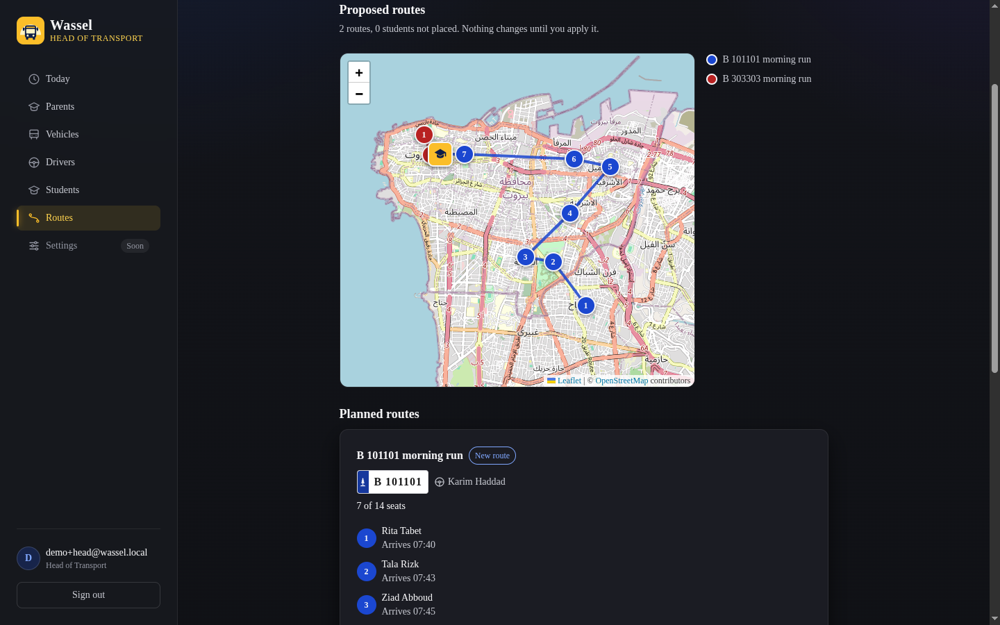
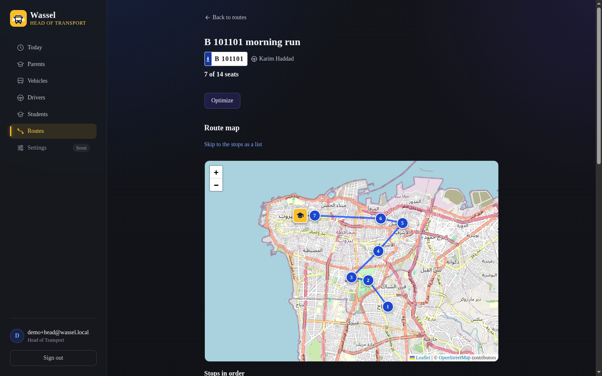
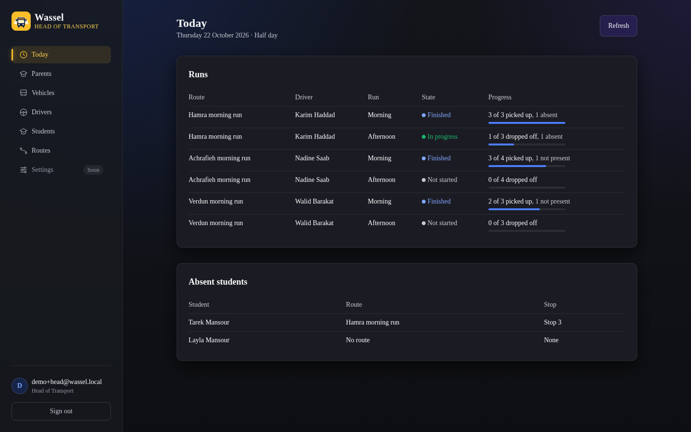

<div align="center">


<br>


**Wassel plans a school's bus routes, guides drivers stop by stop, and keeps one record of every pickup and dropoff.**

*For private schools that run their own transport. Four roles: head of transportation, driver, parent and admin.*

</div>

<br>

## 🚌 The problem

Most private schools run transport on phone calls, WhatsApp groups and paper lists. A route is drawn once in September. Absences travel by phone. The school office hears about problems from parents, and cannot answer one who asks where their child is.

<table width="100%">
<tr>
<th align="left" width="22%"></th>
<th align="left" width="39%">Transport today</th>
<th align="left" width="39%">With Wassel</th>
</tr>
<tr>
<td><b>Coordination</b></td>
<td>Phone calls, WhatsApp groups and paper lists</td>
<td>One web platform for routes, drivers and student assignments</td>
</tr>
<tr>
<td><b>Routes</b></td>
<td>Drawn once in September, absences passed along by phone</td>
<td>Optimized automatically around the students who are actually riding</td>
</tr>
<tr>
<td><b>Parent visibility</b></td>
<td>The office cannot say where a child is</td>
<td>Every pickup and dropoff recorded with the time it happened</td>
</tr>
<tr>
<td><b>Oversight</b></td>
<td>The office learns about problems from parents</td>
<td>The whole morning on a single screen</td>
</tr>
</table>

## 🗺️ What it looks like

<div align="center">

<br>
<sub><b>Generate routes.</b> The optimizer splits the demo school's 10 students across two buses, orders every stop and works out arrival times backwards from the school bell. Nothing changes until the head of transportation applies it.</sub>
</div>

<br>

<div align="center">


<br>
<sub>Left: one route, with its bus, driver and stops on the map. Right: the Today screen, every run's state and progress at a glance (shown with sample data, see below). Screenshots use the built-in demo school and made-up names.</sub>
</div>

## 👥 Who it is for

<table width="100%">
<tr>
<th align="left" width="22%">Role</th>
<th align="left">What they do in Wassel</th>
</tr>
<tr>
<td><b>Head of transportation</b></td>
<td>Keeps the vehicles, drivers, students and parents. Builds routes by hand or generates all of them, reviews the proposal on a map, and applies it. Sees every run's state on the Today screen.</td>
</tr>
<tr>
<td><b>Driver</b></td>
<td>Opens the day's run on a phone: the stops in order, the next stop highlighted, directions in a maps app, a call button for the parent, and Picked up, Dropped off and Not present at each stop. The screen is built and still runs on sample data until it is connected to the live runs API.</td>
</tr>
<tr>
<td><b>Parent</b></td>
<td>Reports a child absent for a day or a date range, and sees the child's route, driver, expected pickup time and today's run status. The API for all of this is done and tested. The parent screens are the next piece of work.</td>
</tr>
<tr>
<td><b>Admin</b></td>
<td>Sets the school's arrival and dismissal times, its holidays and half-days, and invites heads of transportation.</td>
</tr>
</table>

## ✅ What works today, and what is next

<table width="100%">
<tr>
<th align="left" width="50%">Works today</th>
<th align="left" width="50%">Next</th>
</tr>
<tr>
<td valign="top">
Sign-in with an emailed code, lockout, invites, password reset<br>
Vehicles with seat capacity, drivers, students, parents<br>
Student CSV import and address-to-map-pin lookup<br>
Hand-built routes, one-click route optimization with review<br>
Generate every route for the school, capacity never exceeded<br>
School times, holidays and half-days<br>
Backend for daily runs, start and end, pickup and dropoff confirmations<br>
Backend for absences and the parent's view of a child
</td>
<td valign="top">
Driver and Today screens on live data (they run on sample data today)<br>
Parent screens (the parent area is a stub on <code>develop</code>)<br>
Notifications to parents<br>
Live bus tracking on a map<br>
Confirmations without a connection<br>
Arabic and right-to-left screens
</td>
</tr>
</table>

## 🧠 How it works

- **Routes.** [Google OR-Tools](https://developers.google.com/optimization) orders each route's stops and, for a whole school, decides which students ride which bus. It respects every vehicle's seats and plans backwards from the school's arrival time, never starting a route before 06:00. Driving times come from [OpenRouteService](https://openrouteservice.org) and fall back to straight-line estimates if it is down or has no key.
- **Addresses.** A typed address becomes a map pin through Nominatim, limited to Lebanon. A pin can always be placed by hand.
- **Runs.** A run is one route, one direction, one date, created when the day is first asked for. Each confirmation is stored with its time, and the latest status wins.
- **Security.** The session is a JWT in an `HttpOnly`, `SameSite=Strict` cookie. Every sign-in needs an emailed 6-digit code. Five wrong passwords lock the account for 15 minutes. Every query is scoped to the caller's school, and a test fails the build if any endpoint has no role rule.
- **Quality.** 67 backend test classes run on a real PostgreSQL 16 in Testcontainers, with Flyway migrations validated by Hibernate. 46 frontend test files run on Vitest. Many suites were written by a teammate who did not write the feature. CI runs tests, lint, build and `npm audit` on every push. An OWASP ZAP scan of the deployed app found no failures; its report is in [docs/testing](docs/testing/SCRUM-257/).

## 🚀 Run it

You need **Java 21**, **Node 24+** and **Docker**.

```bash
cp .env.example .env                       # defaults work for local development
docker compose up -d                       # PostgreSQL 16 on :5432

cd backend                                 # API on :8080, with the demo school
DEMO_DATA_ENABLED=true ./mvnw spring-boot:run -Dspring-boot.run.profiles=local

cd frontend                                # app on :3000, in a second terminal
echo "NEXT_PUBLIC_API_BASE_URL=http://localhost:8080" > .env.local
npm install && npm run dev
```

Open <http://localhost:3000> and sign in. Locally no email is sent: the sign-in code is printed in the backend console, on the line that starts with `Email to`.

| Account | Email | Password |
| --- | --- | --- |
| Head of transportation | `demo+head@wassel.local` | `local-demo-password` |
| Driver | `demo+driver-karim@wassel.local` | `local-demo-password` |
| Parent (two children) | `demo+parent@wassel.local` | `local-demo-password` |
| Admin | `admin@wassel.local` | `local-admin-password` |

The demo school has 3 vehicles, 3 drivers and 10 students with pins around Beirut. Sign in as the head of transportation, open **Routes**, and press **Generate routes**.

```bash
cd backend && ./mvnw verify                # needs Docker running, for the PostgreSQL container
cd frontend && npm test                    # Vitest
```

A hosted copy runs at <https://wassel-sooty.vercel.app>, but every sign-in emails a code to a real inbox, so use the local setup above to try it. Staging, email, deployment, the post-deploy smoke test and logs are in [docs/operations.md](docs/operations.md).

## 🧱 How it is built

| Layer | Tech |
| --- | --- |
| **Frontend** | Next.js 15 (App Router), React 19, Tailwind v4, framer-motion, Leaflet with OpenStreetMap |
| **Backend** | Java 21, Spring Boot 4.1, Spring Security, JPA, Flyway, OR-Tools |
| **Data** | PostgreSQL 16 |
| **Quality** | JUnit and Testcontainers, Vitest and Testing Library, JaCoCo, GitHub Actions, Dependabot, OWASP ZAP |
| **Hosting** | Vercel (frontend), Railway (backend and database), Docker Compose for staging with Loki and Grafana logs |

```
.
├── backend/     # Spring Boot, one module per feature: auth, routes, runs, absences, parent, ...
├── frontend/    # Next.js, one route group per role: (admin) (driver) (head-of-transport) (parent) (public)
├── docs/        # API contracts, test plans and reports, the operations guide, the demo-video brief
├── ops/         # Loki, Promtail and Grafana config for the staging logs
└── scripts/     # post-deploy smoke test
```

The rules each half follows are written down: [backend/CLAUDE.md](backend/CLAUDE.md) for the module structure, security and testing rules, and [frontend/CLAUDE.md](frontend/CLAUDE.md) for the design system. The API shapes the teams agreed on are in [docs/contracts](docs/contracts/).

<br>

<div align="center">

**Wassel** · **واصل**

**Team:** Hashem Awad · Majd Al Halabi · Wassim Fawaz · Moustafa Hashem · Mohamad A. Al Hamwi

<sub>Group 1, CMPS 271 Software Engineering · American University of Beirut · Fall 2026</sub>

</div>
